# aws-pr-previews — Project Specification

> **Status:** v1.0 scope locked on 2026-10-16. Revised the same day: Lambda Function URLs replace ECS Fargate plus a load balancer, TypeScript replaces Python, and compute sits behind a backend interface so an ECS backend can be added later.
> **Working name:** `aws-pr-previews`, backend-neutral on purpose. Rename before publishing if you prefer. GitHub owner is `Pantelijaa`.
> **Companion documents:** [AGENTS.md](AGENTS.md) (how we work), [IMPLEMENTATION_PLAN.md](IMPLEMENTATION_PLAN.md) (what we build, in which order, and what you learn at each step).
> **Reading tip:** this is the technical source of truth and uses AWS vocabulary freely. Every term that gets a concept note is listed in the concept map at the end of the implementation plan. You are not expected to understand this whole document before Step 1.

---

## 1. One-liner

Per-pull-request preview environments on AWS: a **GitHub Action** plus a **Terraform module** that gives every PR a live HTTPS URL running its container image in **your own AWS account**, at zero cost while idle, and removes it when the PR closes.

```yaml
- uses: Pantelijaa/aws-pr-previews@v1
  with:
    stack: main
    image: ${{ steps.build.outputs.image }}
```

Result, as a sticky comment on the PR:

> 🟢 **Preview ready:** https://k7x2…ab.lambda-url.eu-central-1.on.aws/
> Image `api:pr-42-3f9c1e2` · [Logs](…) · expires 2026-10-19 14:05 UTC
> Redeploys on every push. Removed when the PR closes.

---

## 2. Problem

- Reviewers, designers and QA need to *click through* a change, not read a diff. Vercel, Netlify and Cloudflare Pages solved this for frontends. Backend services and arbitrary containers have no cheap, self-hosted equivalent on AWS.
- Existing options each miss. **PullPreview** targets Lightsail/Hetzner and needs a paid license for for-profit orgs. **Cloud Posse's** version is a large reference architecture built on Atmos. **Superset** built a project-specific one on ECS. Blog posts stop at "deploy the container" and never handle teardown.
- Hand-rolled solutions leak money because forgotten environments keep running. **Cleanup is the actual hard part**, and the part everyone skips.

## 3. Goals

| ID | Goal |
|----|------|
| G1 | One workflow step turns a container image into a live HTTPS URL and posts it as a sticky comment on the PR. |
| G2 | Closing the PR removes every per-PR resource. A scheduled **reaper** removes anything the workflow missed, by TTL. Nothing lingers. |
| G3 | Shared infrastructure is **one Terraform module**, applied once per AWS account and region. No VPC, no domain, no load balancer required. |
| G4 | Failures are diagnosable from the Actions log and PR comment alone: function state, last log lines, HTTP probe result, and a hint for the common causes. |
| G5 | **Zero idle cost.** A stack with no open PRs costs nothing. An open preview costs nothing until someone requests it. |
| G6 | Least privilege: the GitHub OIDC role is scoped to one function-name prefix, one log group and one SSM path. Secrets never appear as plaintext in workflow files. |
| G7 | **Learning goal:** the maintainer can explain and defend every component in an interview. Each concept has a short note in `docs/concepts/`, written before the code that uses it. |
| G8 | **Portfolio goal:** visibly exercise Docker (Dockerfiles, multi-arch awareness, ECR lifecycle, Trivy), AWS (Lambda container images, Function URLs, ECR, IAM + OIDC, EventBridge, SSM, CloudWatch, Resource Groups Tagging), TypeScript (strict, bundled action, SDK v3, tested with mocks) and CI/CD (lint/test/scan, Terraform plan-on-PR and apply-on-main via OIDC, release automation, dogfooding). |
| G9 | **Extensibility:** compute is a **backend** behind one small interface. v1.0 ships the Lambda backend; an ECS Fargate plus load balancer backend is the first roadmap item and must slot in without touching the action, CLI, comment, naming or reaper. |

## 4. Non-goals (v1.0)

Out of scope on purpose. Each is a roadmap candidate (§17), not a silent extension of v1.0.

- Any backend other than Lambda. ECS Fargate plus ALB is designed for (§7.3) but not built.
- Building the user's image. The action **deploys** an image URI; the user builds and pushes with standard steps (example provided).
- Custom domains per preview. v1.0 uses the AWS-provided Function URL hostname.
- Secrets injection by the action. Apps read secrets at runtime from SSM or Secrets Manager (§9.8); the function role allows it.
- WebSockets, requests longer than 15 minutes, responses over 6 MB without streaming. These are Lambda limits and are documented, not worked around.
- Authentication in front of previews. URLs are unguessable but public.
- GitLab or Bitbucket wrappers. Multi-container previews. Databases per preview. A dashboard. Chat notifications.

## 5. Learning model

This repository is built by someone learning AWS from zero, and the README says so. That is a feature: "learn Lambda, IAM and Terraform by building a real tool" is a story people star.

- **Concept notes** live in `docs/concepts/<slug>.md`, one per concept, roughly 40–60 lines each. Template in [AGENTS.md](AGENTS.md).
- **Order of work** in the implementation plan is chosen so no step uses a concept that an earlier step has not introduced.
- **Loop per step:** concepts → smallest deliverable → verification → interview questions → stop.
- **Interview prep** is part of each concept note: three to five questions with short model answers. Networking (VPC, subnets, security groups, load balancers) gets an interview-only note even though v1.0 builds none of it, because it is the most asked topic and the ECS backend will need it.

## 6. Users and primary scenario

**Primary persona:** a developer or small team that ships an HTTP service as a container, has an AWS account, and wants PR previews without a SaaS and without a monthly bill. **Secondary:** a platform engineer evaluating a self-hosted baseline.

**What the user's image must satisfy**

1. Listen for HTTP on a port (default 8080) and start within a few seconds.
2. Include the **AWS Lambda Web Adapter**, one line in the Dockerfile:
   ```dockerfile
   COPY --from=public.ecr.aws/awsguru/aws-lambda-adapter:1.0.1 /lambda-adapter /opt/extensions/lambda-adapter
   ```
   The adapter is inert outside Lambda, so the same image runs unchanged on a laptop, on ECS, or anywhere else.
3. Be built for the architecture the preview runs on (`x86_64` by default). A `linux/arm64` image on an `x86_64` function fails at start; the diagnostics say so.

**Happy path**

1. The platform owner applies the Terraform module once. Outputs include an IAM role ARN for GitHub and the name of an SSM parameter holding the stack config.
2. The developer adds this workflow to the service repo:

```yaml
name: preview
on:
  pull_request:
    types: [opened, synchronize, reopened, closed]
permissions:
  id-token: write        # OIDC token for AWS
  contents: read
  pull-requests: write   # sticky comment
concurrency:
  group: preview-${{ github.event.pull_request.number }}
  cancel-in-progress: true
jobs:
  preview:
    runs-on: ubuntu-latest
    steps:
      - uses: actions/checkout@v4
      - uses: aws-actions/configure-aws-credentials@v4
        with:
          role-to-assume: arn:aws:iam::123456789012:role/aws-pr-previews-main-github
          aws-region: eu-central-1
      - uses: aws-actions/amazon-ecr-login@v2
        id: ecr
        if: github.event.action != 'closed'
      - id: build
        if: github.event.action != 'closed'
        run: |
          IMAGE=${{ steps.ecr.outputs.registry }}/api:pr-${{ github.event.number }}-${GITHUB_SHA::7}
          docker build -t "$IMAGE" .
          docker push "$IMAGE"
          echo "image=$IMAGE" >> "$GITHUB_OUTPUT"
      - uses: Pantelijaa/aws-pr-previews@v1
        with:
          stack: main
          name: api
          image: ${{ steps.build.outputs.image }}
          health-check-path: /healthz
```

3. On open or push the action deploys, probes the URL until it answers, and comments the URL. On close or merge it removes everything and updates the comment to "🗑️ Preview removed".
4. If the workflow never ran `down` (broken workflow file, deleted branch), the reaper deletes the preview after its TTL.

---

## 7. Architecture

```mermaid
flowchart LR
  subgraph GitHub
    PR[Pull request] --> WF[Workflow]
    WF -->|OIDC| STS[AWS STS]
    WF -->|docker push| ECR
    WF -->|up / down| ACT[aws-pr-previews action<br/>TypeScript, bundled dist/index.js]
    ACT -->|sticky comment| PR
  end

  subgraph AWS["AWS account · one region · one stack"]
    SSM[(SSM parameter<br/>/aws-pr-previews/main/config)]
    ACT -->|read config| SSM
    ACT -->|CreateFunction / UpdateFunctionCode<br/>from ECR image| L1[Lambda api-pr-42]
    ACT -->|CreateFunctionUrlConfig| U1[Function URL<br/>https://…lambda-url…on.aws]
    ACT -->|HTTP probe, logs on failure| U1
    U1 --> L1
    L1 -->|awslogs| CW[CloudWatch Logs<br/>/aws-pr-previews/main]
    L1 -.->|reads at runtime| SEC[(SSM / Secrets Manager<br/>/aws-pr-previews/main/*)]
    EB[EventBridge<br/>rate 1 hour] --> REAPER[Reaper Lambda]
    REAPER -->|find by tag, expires-at < now<br/>DeleteFunction| L1
  end
```



### 7.1 Static vs dynamic resources

| Layer | Managed by | Lifetime | Contents |
|-------|-----------|----------|----------|
| **Static, per stack** | Terraform module | Months | ECR repositories with lifecycle policies, the preview execution role, a shared CloudWatch log group, IAM (GitHub deploy role, reaper role), reaper Lambda with schedule, SSM config parameter. Nothing in this list has an hourly charge. |
| **Dynamic, per PR** | The CLI, through the AWS SDK, invoked by the action | Hours to days | One Lambda function from the user's image, its Function URL and invoke permission, its log streams. Every one tagged `pr-previews:*`. |

**Why not Terraform per PR?** It would need state per PR, locking, a Terraform binary inside the action and one to two minutes per run. Direct SDK calls take seconds, are idempotent because every resource is looked up by a deterministic name, and the reaper can find leftovers by tag without any state.

**Why Lambda?** Previews are bursty, mostly idle and short-lived, which is exactly Lambda's shape. A Function URL is a free HTTPS endpoint with a certificate, so no domain, DNS, load balancer or VPC is needed, and a stack with no open PRs costs nothing.

### 7.2 Components

| Component | Where | Responsibility |
|-----------|-------|----------------|
| **Core** | `src/preview.ts`, `naming.ts`, `config.ts`, `probe.ts` | `up` and `down` orchestration, naming and tags, SSM config, HTTP readiness probe. Backend-agnostic. |
| **Backend: Lambda** | `src/backends/lambda.ts` | Create or update the function, Function URL and permission; delete; collect diagnostics. The only file that knows Lambda exists. |
| **GitHub Action** | `action.yml`, `src/action.ts` → `dist/index.js` | Thin wrapper: inputs and event payload → core, outputs, sticky comment (`src/comment.ts`). |
| **CLI** | `src/cli.ts` | Same core from a terminal, for local testing and non-GitHub CI. Uses Node's built-in `parseArgs`. |
| **Reaper** | `src/reaper.ts` → `dist/reaper.js` | Finds expired previews by tag and calls the backend's `destroy`. Runs on a schedule as a Lambda. |
| **Terraform module** | `terraform/modules/aws-pr-previews/` | All static infrastructure. Publishes the SSM config. |
| **Example root** | `terraform/examples/complete/` | The maintainer's real deployment. Used by the dogfood workflow and as copy-paste documentation. |
| **Demo app** | `examples/demo-app/` | ~25-line TypeScript HTTP server, run by Node directly, that prints PR number, commit and build time, plus `/healthz`. Includes the Web Adapter line. Used for dogfooding and the README GIF. |

### 7.3 The backend interface

```ts
interface Backend {
  /** Create or update the preview and return its public URL. Idempotent. */
  deploy(spec: PreviewSpec, config: StackConfig): Promise<{ url: string }>;
  /** Remove every resource of the preview. A missing preview is a no-op. */
  destroy(previewId: string, config: StackConfig): Promise<void>;
  /** Everything a human needs to see when the probe fails. */
  diagnose(previewId: string, config: StackConfig): Promise<Diagnostics>;
}
```

`PreviewSpec` carries image, port, memory, timeout, architecture, env, health path, TTL and metadata. `Diagnostics` is `{ state: string; reason?: string; logLines: string[]; hint?: string }`. The core selects the backend from `config.backend` (`"lambda"` in v1.0). Readiness is checked by the core with an HTTP probe on the returned URL, so a new backend only has to implement these three methods. The reaper discovers previews by tag and calls `destroy`, so it needs no backend-specific code beyond the resource type filter.

The future **ECS Fargate plus ALB backend** would add `backends/ecs.ts` (task definition, service, target group, listener rule) and Terraform for VPC, cluster, certificate, DNS and ALB behind a `backend = "ecs"` module variable. The plan's roadmap lists the exact steps.

---

## 8. Behaviour

### 8.1 `up`

1. **Load config** from SSM `/aws-pr-previews/<stack>/config` (§9.3). A missing parameter fails fast: "Stack 'main' not found. Did you apply the Terraform module, and may this role read the parameter?"
2. **Derive names** (§9.4) and **tags** (§9.5). `expires-at = now + ttl`.
3. **Deploy through the backend.** For Lambda:
   - Function absent → `CreateFunction` with `PackageType=Image`, the image URI, the preview execution role, memory, timeout, architecture, the stack log group via `LoggingConfig`, environment (§9.8), tags. Then `CreateFunctionUrlConfig` (auth `NONE`, invoke mode from spec) and `AddPermission` for `lambda:InvokeFunctionUrl` to principal `*`. Wait for state `Active`.
   - Function present → `UpdateFunctionCode` with the new image URI, then `UpdateFunctionConfiguration` for env, memory and timeout if they changed, refresh the `expires-at` tag. Wait for `LastUpdateStatus=Successful`. The Function URL is stable across updates, so the preview keeps its address.
   - If an existing function carries a different `pr-previews:repo` tag, refuse with a clear message.
4. **Probe** (§8.4) the URL plus health path until it answers 200–399, or fail.
5. **Emit outputs** and, in GitHub mode, upsert the sticky comment (§8.5).

### 8.2 `down`

1. Load config, derive names.
2. `DeleteFunction`. This also removes the Function URL configuration and the resource policy. A `ResourceNotFoundException` is a **no-op success** with one log line.
3. Update the sticky comment to "🗑️ Preview removed".

Image tags are not deleted. The ECR lifecycle policy expires `pr-*` tags after `ecr_pr_image_expiry_days`. Log streams expire with the log group's retention.

### 8.3 Reaper

- Runs on an EventBridge schedule (`rate(1 hour)` default). Also runs locally: `npx aws-pr-previews reap --stack main --dry-run`.
- Discovery through the Resource Groups Tagging API: `pr-previews:managed=true` and `pr-previews:stack=<stack>`, resource type `lambda:function`, excluding the reaper itself.
- Every function whose `expires-at` is in the past → `destroy`.
- One structured JSON log line per action. Safe to run concurrently with `up` and `down`: deletes are idempotent and `NotFound` is tolerated. A function mid-update returns `ResourceConflictException`; the reaper skips it and retries on the next run.

### 8.4 Probe and diagnostics

Every 3 s, up to `wait-timeout` (default 120 s), `GET <url><health-check-path>` with a 10 s request timeout. Success is any 200–399 response. The first request also warms the function, so a slow cold start is tolerated by design.

On timeout, print a **diagnostics block** and put a collapsed copy in the PR comment:

- Function `State`, `StateReason`, `LastUpdateStatus`, `LastUpdateStatusReason`.
- The last probe result: HTTP status or network error, first 300 characters of the body.
- Last 50 log lines from the function's streams in the stack log group.
- One hint keyed on common causes:
  - `Runtime.InvalidEntrypoint` or `exec format error` → image built for the wrong architecture, or the Web Adapter line is missing.
  - Adapter readiness timeout in the logs → the app is not listening on `port`, or it listens on `127.0.0.1` instead of `0.0.0.0`.
  - 502 with `Runtime.ExitError` → the process crashed at start; read the lines above it.
  - Probe 404 → `health-check-path` is wrong.
  - Function timeout in logs → raise `timeout` or the app is hanging on startup.

Exit code 1. Resources are **left in place** for inspection; the next push or the reaper cleans up.

### 8.5 Sticky PR comment

- Identified by `<!-- aws-pr-previews:<stack>:<preview-id> -->` on its first line. Found through the issue-comments API, updated in place, created if absent.
- States: 🟡 deploying (posted at the start of `up`), 🟢 ready, 🔴 failed with collapsed diagnostics, 🗑️ removed.
- When ready: URL, short image tag, linked commit, CloudWatch Logs deep link, `expires-at`, one line on the lifecycle and one on cold starts ("first request after a pause takes a few seconds").
- Off with `comment: false`.

### 8.6 Idempotency and concurrency

- Every `up` and every `down` is safe to re-run. Resources are found by deterministic name, never by stored IDs.
- The recommended workflow uses a `concurrency` group per PR. The core also retries `ResourceConflictException` with backoff for up to 60 s, because Lambda rejects a second update while one is in progress.
- Different repos may share a stack as long as their slugs differ.

---

## 9. Interfaces and contracts

### 9.1 GitHub Action (`action.yml`)

`runs: using: node24`, `main: dist/index.js`. The bundle is committed and rebuilt by the release workflow; CI fails if `dist/` is stale.

**Inputs**

| Input | Required | Default | Notes |
|-------|----------|---------|-------|
| `stack` | yes | — | Selects SSM `/aws-pr-previews/<stack>/config`. |
| `command` | no | auto | `up` or `down`. Auto is `down` when the PR event action is `closed`, else `up`. |
| `image` | for `up` | — | ECR image URI with tag or digest, same account and region as the stack. |
| `name` | no | repo name slug | `[a-z0-9-]{1,20}`, see §9.4. |
| `pr-number` | no | from event | Only needed outside `pull_request` events. |
| `port` | no | `8080` | Port the app listens on. Passed to the Web Adapter. |
| `memory` | no | `1024` | MB. Lambda CPU scales with memory. |
| `timeout` | no | `30` | Seconds per request, max 900. |
| `architecture` | no | `x86_64` | Or `arm64`. Must match the image. |
| `env` | no | — | Multiline `KEY=VALUE`. |
| `health-check-path` | no | `/` | Probed until it returns 200–399. Also the adapter's readiness path. |
| `invoke-mode` | no | `BUFFERED` | `RESPONSE_STREAM` for streaming or responses over 6 MB. |
| `ttl-hours` | no | stack default | Refreshed on every `up`. |
| `wait-timeout` | no | `120` | Seconds for the probe. |
| `comment` | no | `true` | Sticky PR comment on or off. |
| `github-token` | no | `${{ github.token }}` | Needs `pull-requests: write`. |

**Outputs:** `url`, `preview-id`, `logs-url`, `expires-at`, `status` (`ready` · `failed` · `removed`).

### 9.2 CLI

```
aws-pr-previews up    --stack S --image URI --name SLUG --pr N
                      [--port 8080] [--memory 1024] [--timeout 30] [--architecture x86_64]
                      [--env K=V]... [--health-check-path /] [--invoke-mode BUFFERED]
                      [--ttl-hours H] [--wait-timeout 120] [--json]
aws-pr-previews down  --stack S --name SLUG --pr N
aws-pr-previews reap  --stack S [--dry-run]
```

Run as `npx aws-pr-previews …` from the repo, or `node dist/cli.js …`. Exit codes: `0` success · `1` preview unhealthy or failed · `2` configuration or permission error · `3` AWS API error after retries.

### 9.3 SSM stack config (`/aws-pr-previews/<stack>/config`, type `String`, JSON)

```json
{
  "version": 1,
  "stack": "main",
  "backend": "lambda",
  "region": "eu-central-1",
  "function_role_arn": "arn:aws:iam::123456789012:role/aws-pr-previews-main-function",
  "log_group_name": "/aws-pr-previews/main",
  "default_ttl_hours": 72,
  "default_memory_mb": 1024,
  "default_timeout_s": 30
}
```

Parsed into a readonly `StackConfig` type with a ten-line validator. Unknown fields are ignored for forward compatibility. A `version` mismatch is a hard error with an upgrade hint. An ECS backend would add its own fields under the same parameter.

### 9.4 Naming

| Thing | Rule |
|-------|------|
| `slug` | `^[a-z0-9][a-z0-9-]{0,19}$`. Default: repo name lower-cased, anything outside `[a-z0-9]` → `-`, runs collapsed, trimmed, cut to 20. |
| `preview-id` | `<slug>-pr-<n>`, at most 31 characters. |
| Lambda function name | `<stack>-<preview-id>` (limit 64). |
| Log stream prefix | Lambda's own: `<date>/[$LATEST]<id>` inside the stack log group, filtered by function name. |
| URL | Assigned by AWS on creation, stable for the function's lifetime. |

### 9.5 Tags on every dynamic resource

| Key | Value |
|-----|-------|
| `pr-previews:managed` | `true` |
| `pr-previews:stack` | stack name |
| `pr-previews:preview-id` | `<slug>-pr-<n>` |
| `pr-previews:pr` | PR number |
| `pr-previews:repo` | `owner/repo` when known |
| `pr-previews:sha` | commit sha when known |
| `pr-previews:created-at` | RFC 3339 UTC |
| `pr-previews:expires-at` | RFC 3339 UTC. The reaper's only decision input. |

### 9.6 Terraform module `terraform/modules/aws-pr-previews`

**Variables**

| Variable | Type | Default | Description |
|----------|------|---------|-------------|
| `name` | string | required | Stack name. Resource prefix, SSM path, tags. |
| `github_repositories` | list(string) | required | `owner/repo` entries allowed to assume the deploy role. |
| `ecr_repositories` | list(string) | `[]` | Repositories to create for app images, with lifecycle policies. |
| `ecr_pr_image_expiry_days` | number | `14` | Lifecycle rule for tags matching `pr-*`; untagged images expire after 1 day. |
| `default_ttl_hours` | number | `72` | |
| `default_memory_mb` | number | `1024` | |
| `default_timeout_s` | number | `30` | |
| `reaper_schedule` | string | `rate(1 hour)` | `""` disables the reaper. |
| `secret_arns` | list(string) | `[]` | SSM or Secrets Manager ARNs preview functions may read, beyond `/aws-pr-previews/<name>/*`. |
| `log_retention_days` | number | `14` | |
| `create_github_oidc_provider` | bool | `true` | `false` plus `github_oidc_provider_arn` when the account already has one. |
| `github_oidc_provider_arn` | string | `null` | |
| `tags` | map(string) | `{}` | |

**Outputs:** `github_actions_role_arn`, `ssm_config_parameter_name`, `ecr_repository_urls`, `function_role_arn`, `log_group_name`, `reaper_function_name`.

**Fixed behaviours:** one shared log group for all previews with `log_retention_days`. The reaper is a Node 22 zip built from `dist/reaper.js`. Every resource carries `pr-previews:stack = <name>`.

### 9.7 IAM

**GitHub deploy role.** Trust: `token.actions.githubusercontent.com`, `sub` matching `repo:<owner>/<repo>:*` for each configured repo. Permissions:

- `ssm:GetParameter` on the stack config parameter.
- `lambda:CreateFunction`, `UpdateFunctionCode`, `UpdateFunctionConfiguration`, `DeleteFunction`, `GetFunction`, `GetFunctionConfiguration`, `TagResource`, `CreateFunctionUrlConfig`, `GetFunctionUrlConfig`, `AddPermission`, `RemovePermission` on `arn:aws:lambda:<region>:<account>:function:<name>-*`.
- `iam:PassRole` on the preview execution role only, condition `iam:PassedToService = lambda.amazonaws.com`.
- `logs:FilterLogEvents`, `DescribeLogStreams` on the stack log group.
- `ecr:GetAuthorizationToken` plus push and pull on stack-owned repositories, so users can push with the same role.
- `tag:GetResources`.

**Reaper role:** `tag:GetResources`, `lambda:GetFunction`, `lambda:ListTags`, `lambda:DeleteFunction` on the same name pattern, plus its own logs.
**Preview execution role** (passed to every preview function): `AWSLambdaBasicExecutionRole` scoped to the stack log group, `ecr` pull, `ssm:GetParameter*` and `secretsmanager:GetSecretValue` on `/aws-pr-previews/<name>/*` and `var.secret_arns`.

### 9.8 Environment variables set on the function

Adapter: `AWS_LWA_PORT=<port>`, `AWS_LWA_READINESS_CHECK_PATH=<health-check-path>`, `AWS_LWA_INVOKE_MODE=<invoke-mode>`. Convenience: `PORT=<port>`. Metadata: `PR_PREVIEW_ID`, `PR_PREVIEW_PR`, `PR_PREVIEW_SHA`, `PR_PREVIEW_REPO`, `PR_PREVIEW_EXPIRES_AT`. User-provided `env` wins on conflict.

Secrets are not injected. The README shows the pattern: store them under `/aws-pr-previews/<stack>/<slug>/…` and read them at startup with the SDK or the Parameters and Secrets Lambda extension.

---

## 10. Repository layout

```
aws-pr-previews/
├── action.yml                      # node24, main: dist/index.js
├── package.json  package-lock.json  tsconfig.json  biome.json
├── src/
│   ├── action.ts                   # GitHub entry: inputs, event, comment, outputs
│   ├── cli.ts                      # terminal entry via node:util parseArgs
│   ├── preview.ts                  # up / down orchestration over a Backend
│   ├── config.ts                   # StackConfig type, validator, SSM loader
│   ├── naming.ts                   # slug, previewId, functionName, tags   (pure)
│   ├── probe.ts                    # HTTP readiness probe                  (pure-ish, fetch)
│   ├── comment.ts                  # sticky comment rendering + upsert
│   ├── reaper.ts                   # TTL sweep; exports the Lambda handler
│   └── backends/
│       ├── backend.ts              # Backend interface, PreviewSpec, Diagnostics
│       └── lambda.ts               # the Lambda implementation
├── dist/                           # committed bundles: index.js, cli.js, reaper.js
├── tests/                          # vitest; aws-sdk-client-mock; fixtures/ with real payloads
├── terraform/
│   ├── modules/aws-pr-previews/    # ecr.tf iam.tf logs.tf reaper.tf ssm.tf
│   │                               # variables.tf outputs.tf versions.tf README.md
│   ├── bootstrap/                  # S3 state bucket, applied once with local state
│   └── examples/complete/          # the maintainer's deployment
├── examples/
│   ├── demo-app/                   # server.ts, Dockerfile (with Web Adapter line)
│   └── workflows/preview.yml       # copy-paste workflow for users
├── docs/
│   ├── concepts/                   # one short note per concept (see §5)
│   ├── costs.md
│   └── troubleshooting.md
├── .github/workflows/              # ci.yml terraform.yml dogfood.yml release.yml
├── README.md  LICENSE  CONTRIBUTING.md  CHANGELOG.md
├── PROJECT_SPECIFICATION.md  AGENTS.md  IMPLEMENTATION_PLAN.md
└── .gitignore  .editorconfig
```

## 11. Tech stack

| Area | Choice | Why |
|------|--------|-----|
| Language | TypeScript, strict, Node 22 LTS | One language for action, CLI and reaper. Action runs on `node24`; the reaper runs on the `nodejs22.x` Lambda runtime. |
| Package manager | npm | Built in, no extra tooling. |
| Bundler | `esbuild` | One command produces `dist/index.js`, `dist/cli.js`, `dist/reaper.js`. |
| Runtime deps | `@aws-sdk/client-lambda`, `client-ssm`, `client-cloudwatch-logs`, `client-resource-groups-tagging-api`, `@actions/core`, `@actions/github` | That is the whole budget. |
| Dev deps | `typescript`, `esbuild`, `vitest`, `@biomejs/biome`, `aws-sdk-client-mock`, `@types/node` | Biome replaces ESLint plus Prettier with one tool. |
| Tests | `vitest` with `aws-sdk-client-mock` | The standard way to test SDK v3 calls without AWS. |
| IaC | Terraform ≥ 1.10 (S3 backend with native lockfile), AWS provider 5.x | |
| IaC quality | `terraform fmt`, `validate`, `tflint`, `checkov`, `terraform-docs` | |
| Containers | Demo app on `node:24-slim`, non-root, Web Adapter line, Trivy scan | |
| Registry | ECR, created by the module. The action itself needs no registry. | |

## 12. Quality

### 12.1 Tests

- **Pure unit tests:** naming, tag building, env parsing, config validation, diagnostics hints, comment rendering.
- **Mocked SDK flow tests:** `up` creates function, URL and permission with the right tags; a second `up` updates instead of creating; `down` deletes and is a no-op the second time; `reap` removes expired, keeps live; `ResourceConflictException` is retried.
- **Dogfood, every PR:** `dogfood.yml` builds the demo app, pushes to the stack's ECR and runs `uses: ./`. Every PR to this repo gets a real preview URL, and closing it exercises `down`. This is the integration test.
- **Terraform:** `fmt -check`, `validate`, `tflint`, `checkov` on every PR; `plan` output commented on the PR; `apply` on `main` behind a GitHub Environment with a required reviewer.

### 12.2 Workflows

| Workflow | Trigger | Jobs |
|----------|---------|------|
| `ci.yml` | PR, push to `main` | `biome ci` · `tsc --noEmit` · `vitest` · `npm run build` and fail if `dist/` differs · `docker build examples/demo-app` · Trivy image scan failing on HIGH and CRITICAL · `actionlint` · `gitleaks`. |
| `terraform.yml` | PR touching `terraform/**`, push to `main` | fmt, validate, tflint, checkov · `plan` in `examples/complete` via OIDC with the summary as a PR comment · `apply` on `main` in environment `aws-main` with manual approval. |
| `dogfood.yml` | `pull_request` opened, synchronize, reopened, closed | build and push demo app → `uses: ./` → `curl` the URL. |
| `release.yml` | tag `v*.*.*` | rebuild `dist/`, commit it on the tag if changed, move the floating `vX` tag, release notes from Conventional Commits, `npm audit` gate. |

### 12.3 Security scanning

Trivy (demo image and IaC), checkov, `npm audit`, Dependabot for npm, docker, github-actions and terraform, `gitleaks` in CI.

## 13. Cost model

Approximate, eu-central-1, verify with the AWS pricing calculator.

| Item | Monthly | Notes |
|------|---------|-------|
| Lambda previews | 0 within the always-free tier (1 M requests, 400 000 GB-seconds) | A preview that nobody opens costs nothing. Heavy use of a 1 GB function: about 0.017 USD per 1 000 requests of 1 s. |
| Function URLs | 0 | No charge beyond invocations. |
| Reaper Lambda, EventBridge, SSM, Tagging API | 0 | Inside free tiers. |
| CloudWatch Logs | 0 up to 5 GB ingested, then ~0.60 USD per GB | 14-day retention. |
| ECR | ~0.10 USD per GB-month | Lifecycle policies keep it small. |
| S3 state bucket | cents | |
| **Typical total** | **under 1 USD** | No fixed hourly charge anywhere in the stack. |

The future ECS backend adds a load balancer at ~20 USD per month and, optionally, a domain. `docs/costs.md` keeps both tables.

## 14. Limits and quotas

| Limit | Value | Effect |
|-------|-------|--------|
| Lambda concurrent executions | 1 000 default per region, **often 10 on brand-new accounts** | Request an increase in Service Quotas early; the plan's Step 0 does this. |
| Request duration | 900 s max; default `timeout` 30 s | Long-polling and WebSockets are out. |
| Response size | 6 MB buffered, larger with `RESPONSE_STREAM` | Large downloads need streaming mode. |
| Container image size | 10 GB | Not a practical constraint. |
| Cold start | ~1–5 s for a typical image after idle | The comment says so. The probe warms the function. |
| Function name length | 64 | Enforced by §9.4. |

## 15. Security considerations

- Function URLs use auth type `NONE`. They are long random hostnames, unguessable but public. The README says so and the roadmap has IAM auth behind CloudFront.
- No long-lived AWS keys anywhere. GitHub OIDC only, trust pinned to configured repositories.
- The deploy role can only touch functions whose name starts with the stack prefix, one log group and one SSM parameter.
- The action never reads or prints secret values. Secrets are read by the app at runtime with a role that only sees its stack's prefix.
- Supply chain: `dist/` rebuilt and verified in CI, Dependabot on every ecosystem, `npm audit` and Trivy gates, `gitleaks`.

## 16. Acceptance criteria for v1.0

- [ ] `terraform apply` of `terraform/examples/complete` on a fresh account succeeds in one run and outputs a role ARN and the SSM parameter name.
- [ ] Opening a PR on this repo yields a 🟢 comment with a working HTTPS URL within 2 minutes of the push (median).
- [ ] A new commit redeploys to the same URL without creating a second function.
- [ ] Closing the PR deletes the function; the comment shows 🗑️. Re-running `down` is a no-op.
- [ ] A preview with `expires-at` in the past is removed by the next reaper run.
- [ ] A preview whose image lacks the Web Adapter line fails within `wait-timeout` with diagnostics that name the cause.
- [ ] The deploy role cannot delete a function outside the stack prefix (negative test).
- [ ] All four workflows are green on `main`; badges in the README.
- [ ] `v1.0.0` is tagged, `dist/` matches source, and `uses: Pantelijaa/aws-pr-previews@v1` works from another repository.
- [ ] README has: 60-second pitch, GIF of a PR receiving a URL, architecture diagram, quick start, the Dockerfile requirement, inputs and outputs table, cost table, limits, FAQ, comparison with PullPreview, and a "built as a learning project" section linking `docs/concepts/`.
- [ ] Listed on the GitHub Marketplace. MIT license, CONTRIBUTING, issue templates.

## 17. Roadmap after v1.0

1. **ECS Fargate plus ALB backend.** `backends/ecs.ts`, Terraform for VPC, cluster, ACM certificate, wildcard DNS and ALB behind `backend = "ecs"`. Gives stable custom hostnames, WebSockets and long requests. The plan's roadmap section lists the steps.
2. **Custom hostnames for the Lambda backend** through CloudFront or API Gateway with a wildcard certificate.
3. **Authentication** in front of previews (CloudFront with IAM-signed origin, or GitHub login at the edge).
4. **Reaper aware of PR state**, so closed PRs are reaped at once even when the workflow never ran.
5. **Secrets injection** through the Parameters and Secrets Lambda extension, configured by the action.
6. **Cost line in the comment**: invocations and GB-seconds since creation.
7. **GitLab CI template** around the same CLI.
8. **Chat notifications** for deploys and reaper runs.

## 18. Decision log

| # | Decision | Alternatives | Rationale |
|---|----------|--------------|-----------|
| D1 | Lambda container images with Function URLs | ECS Fargate plus ALB (~20 USD per month idle), App Runner (~2.5 USD per idle preview, minutes to create) | Zero idle cost, seconds to a URL, no domain or network to manage, and the shape of previews matches Lambda. Supersedes the original Fargate decision. |
| D2 | TypeScript everywhere, JavaScript action | Python in a Docker container action | Marketplace convention, sub-second start, cross-platform runners, TypeScript on the CV. One language for action, CLI and reaper. |
| D3 | Compute behind a `Backend` interface | Lambda calls inline | Keeps the ECS backend a contained addition; the core, comment, naming and reaper never change. |
| D4 | Per-PR resources through the SDK, static ones through Terraform | Terraform workspace per PR | Seconds instead of minutes, no per-PR state, tag-based discovery lets the reaper work without state. |
| D5 | AWS Lambda Web Adapter as the only image requirement | Require apps to implement the Lambda handler API | One Dockerfile line, app code unchanged, same image runs anywhere. |
| D6 | Shared log group via Lambda `LoggingConfig` | One log group per function | One retention setting, one place to search, nothing to delete on `down`. |
| D7 | Readiness by HTTP probe in the core | Backend-specific health APIs | Works for any backend; only diagnostics are backend-specific. |
| D8 | Secrets read by the app at runtime | Action resolves secrets into env | Keeps secret values out of the action and out of function configuration. |
| D9 | Image cleanup through ECR lifecycle policies | Delete tags in `down` | Zero code, same outcome. |
| D10 | Node's `parseArgs` for the CLI, Biome for lint and format, esbuild for bundling | commander, ESLint plus Prettier, ncc | Smallest toolchain that does the job. |
| D11 | Dogfood workflow is the integration test | Separate nightly integration workflow | Every PR already proves the whole path. |
| D12 | MIT license | Apache-2.0 | Lowest adoption friction, matches most Marketplace actions. |
